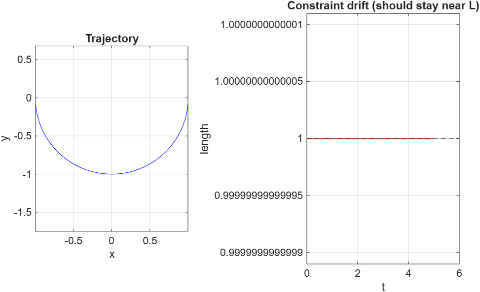

# Simple Index-1 DAE: Pendulum in Cartesian Coordinates

This repository contains a MATLAB demonstration of a classic **index-1 differential-algebraic equation (DAE)** — a simple pendulum written in Cartesian coordinates with an algebraic length constraint.

The code is extracted from the larger demo `A3_ode_dae_solver_demo.m` and focuses only on the DAE pendulum example.

---

## What the code does

The pendulum is modelled with:

- Position `(x, y)` of the bob
- Velocity `(vx, vy)`
- Lagrange multiplier `λ` (related to the tension in the rod)

The equations of motion are:

```
x''  = -λ * x
y''  = -λ * y - g
```

together with the length constraint

```
x² + y² = L²
```

This is naturally an **index-3 DAE**. Differentiating the constraint twice produces an explicit formula for the multiplier:

```
λ = (vx² + vy² - g*y) / L²
```

After this reduction the system is **index-1**.

The demo integrates the differential part with a simple explicit Euler step and then **projects** the position back onto the constraint circle after every step. This keeps the numerical length very close to the ideal value `L`.

---

## Key concepts illustrated

| Concept                    | Explanation |
|---------------------------|-------------|
| Lagrange multiplier `λ`   | Enforces the length constraint; proportional to the tension in the rod |
| Index-3 → Index-1         | Two differentiations of the geometric constraint lower the differential index |
| Stabilisation / projection| Prevents long-term drift away from the original constraint |
| Consistent initialisation | Starting values must satisfy the algebraic constraint |

---

## How to run

Open MATLAB (or GNU Octave) and run the script:

```matlab
pendulum_dae_demo
```

Two figures are produced:

1. Trajectory of the bob in the `(x, y)` plane (should be an arc of a circle)
2. Instantaneous length versus time (should stay very close to `L`)



---

## Mathematical summary

**Newton’s second law with constraint force**

```
x'' = -λ x
y'' = -λ y - g
```

**Position constraint**

```
x² + y² - L² = 0
```

**Velocity-level (hidden) constraint** (first differentiation)

```
x*vx + y*vy = 0
```

**Acceleration-level constraint** (second differentiation)

```
vx² + vy² + x*x'' + y*y'' = 0
```

Substitute the accelerations and solve for the multiplier:

```
λ = (vx² + vy² - g*y) / L²
```

---

## Notes

- The formulation is deliberately elementary (fixed-step Euler + projection) so that the role of the Lagrange multiplier and the need for constraint stabilisation are transparent.
- Production codes would normally use a proper DAE integrator (BDF, Radau, etc.) with consistent initialisation.
- The same physical pendulum can also be written as a pure ordinary differential equation in the angle `θ`. That version needs no multiplier and has no index issues, but the Cartesian DAE form is the one shown here because it demonstrates the concepts above.

---

## Parameters used in the demo

```
g  = 9.81      % gravity (m/s²)
L  = 1.0       % length (m)
dt = 1e-3      % time step (s)
T  = 5         % final time (s)
```

Initial condition: pendulum starts nearly horizontal

```
θ₀ = π/2 - 0.1
x₀ = L * sin(θ₀)
y₀ = -L * cos(θ₀)
vx = vy = 0
λ  = 0
```

---
